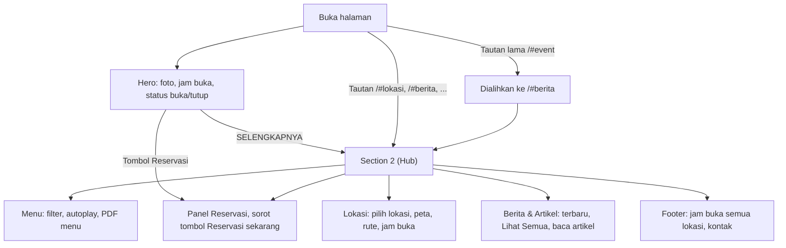
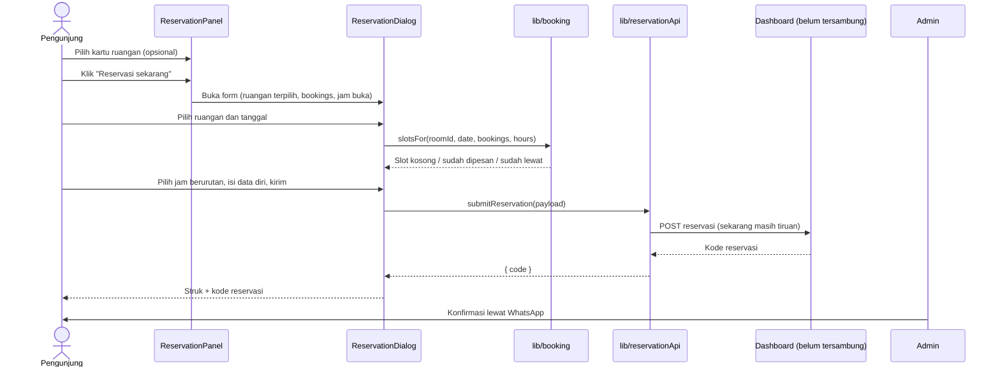
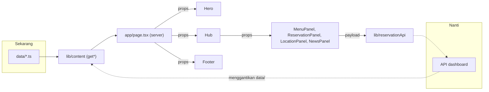

# Arsitektur UB Coffee

Dokumen ini menjelaskan susunan kode website UB Coffee, alur datanya, dan apa saja yang perlu
disiapkan saat landing page disambungkan ke dashboard admin.

## 1. Project Overview

### Latar belakang

Website ini awalnya dibuat sebagai **landing page satu halaman** untuk UB Coffee (unit usaha
PT Brawijaya Multi Usaha, Malang), dengan semua konten ditulis langsung di kode.

Arah project kemudian berubah: akan ada **dashboard admin** untuk mengedit konten landing page
(foto hero, menu, reservasi, berita & artikel, jam buka, dan info situs). Sebelum dashboard
disambungkan, kode sudah dirapikan agar penyambungannya cukup dengan mengganti isi satu lapisan
data (`lib/content/`), tanpa mengubah komponen. Tampilan dan perilaku website tidak berubah.

### Fitur

| Bagian           | Isi                                                                                                |
| ---------------- | -------------------------------------------------------------------------------------------------- |
| Hero             | Slideshow foto layar penuh, logo, jam buka lokasi utama, status buka/tutup (WIB), tombol Reservasi |
| Menu             | Menu best seller dengan filter kategori, autoplay, dan tautan PDF menu lengkap                     |
| Reservasi        | Kartu meeting room, harga sewa dan paket, form reservasi dengan slot per jam                       |
| Lokasi           | Dua lokasi (UB Coffee, Gazebo Corner), peta, rute, tabel jam buka dengan status hari ini           |
| Berita & Artikel | Kabar terbaru, "Lihat Semua" dengan filter kategori dan paginasi, halaman baca artikel             |
| Footer           | Jam buka semua lokasi, kontak WhatsApp dan Instagram, alamat                                       |

Panel di section 2 dipilih lewat hash URL (`#menu`, `#reservasi`, `#lokasi`, `#berita`).
Tautan lama `#event` dialihkan otomatis ke `#berita`.

### Tech stack

- Next.js 16 (App Router, Turbopack) dengan React 19 dan TypeScript
- CSS biasa dengan penamaan BEM (`app/styles/`), tanpa framework CSS
- Motion untuk animasi, dengan dukungan `prefers-reduced-motion`
- `next/image` dan `next/font`
- ESLint dan Prettier

Refactor persiapan dashboard tidak menambah library baru.

## 2. Project Structure

```
ub-coffee/
├── app/
│   ├── layout.tsx            Kerangka HTML, font, metadata, MotionProvider
│   ├── page.tsx              Server component: memanggil lib/content, meneruskan data lewat props
│   ├── globals.css           Hanya @import file di styles/ (urutan menentukan prioritas CSS)
│   ├── styles/               CSS per bagian (base, buttons, hero, hub, panel-*, modal, footer, ...)
│   ├── icon.png              Favicon
│   └── apple-icon.png        Ikon iOS
├── components/
│   ├── Hero.tsx              Hero (client): jam buka + status buka/tutup
│   ├── HeroSlideshow.tsx     Slideshow foto hero
│   ├── Hub.tsx               Section 2 (client): tab, panel aktif dari hash URL
│   ├── Footer.tsx            Footer (server component)
│   ├── ReservationDialog.tsx Form reservasi dalam Modal
│   ├── Modal.tsx             Dialog pop-up
│   ├── PhotoSlideshow.tsx    Slideshow foto generik (kartu ruangan)
│   ├── NewsCard.tsx          Kartu berita
│   ├── NewsArticle.tsx       Teks lengkap berita/artikel
│   ├── OpenStatus.tsx        Label status buka/tutup
│   ├── Icons.tsx             Ikon SVG
│   ├── MotionProvider.tsx    Pengaturan Motion global (reduced motion)
│   └── panels/
│       ├── MenuPanel.tsx
│       ├── ReservationPanel.tsx
│       ├── LocationPanel.tsx
│       └── NewsPanel.tsx
├── data/                     Sumber konten sementara (nanti digantikan API dashboard)
│   ├── heroPhotos.ts
│   ├── menu.ts
│   ├── news.ts               Berita/artikel + newsCategories
│   ├── reservation.ts        Ruangan, harga, paket, jadwal terisi, teks panel
│   ├── site.ts               Info situs, lokasi, jam buka, helper peta place()
│   └── paths.ts              photo()/menuPhoto(): path foto lokal, hanya untuk data/
├── hooks/
│   └── useOpenState.ts       Status buka/tutup di klien, diperbarui tiap menit
├── lib/
│   ├── content/              Lapisan data async (satu-satunya yang membaca data/)
│   │   ├── index.ts
│   │   ├── hero.ts           getHeroPhotos()
│   │   ├── menu.ts           getMenu()
│   │   ├── news.ts           getNews(), getNewsCategories()
│   │   ├── reservation.ts    getRooms(), getBookableRooms(), getBookings(), getRoomPrices(),
│   │   │                     getMeetingPackages(), getReservationText()
│   │   └── site.ts           getSiteInfo(), getLocations(), mainLocation()
│   ├── format.ts             formatDate(), formatTime(), formatHours(), waLink()
│   ├── hours.ts              jakartaNow(), rowForDay(), getOpenState()
│   ├── booking.ts            slotsFor(), helper tanggal WIB
│   ├── menu.ts               menuFilters (diturunkan dari MenuCategory)
│   ├── news.ts               newsTypes, newsByType(), categoryLabel()
│   ├── hubNav.ts             hubTabs, navigate(), tabFromHash(), replaceLegacyHash()
│   └── reservationApi.ts     submitReservation(): satu-satunya titik kirim reservasi
├── types/
│   ├── content.ts            Tipe semua konten (kontrak data dengan dashboard)
│   └── reservation.ts        ReservationPayload, ReservationResult (kontrak kirim)
├── public/images/            Logo, foto suasana (WEBP/), foto menu (menu/)
├── docs/
│   └── ARCHITECTURE.md       Dokumen ini
├── README.md                 Cara menjalankan dan mengubah konten
├── CLAUDE.md, AGENTS.md      Aturan untuk agen AI yang mengerjakan kode
└── package.json, tsconfig.json, next.config.ts, eslint.config.mjs
```

| Folder           | Fungsi                                                                      |
| ---------------- | --------------------------------------------------------------------------- |
| `app/`           | Routing Next.js. `page.tsx` adalah satu-satunya tempat data diambil         |
| `components/`    | Tampilan. Semua data datang lewat props, tidak ada yang import dari `data/` |
| `data/`          | Konten mentah sementara. Hanya dibaca oleh `lib/content/`                   |
| `hooks/`         | Hook React untuk logika klien (status buka/tutup)                           |
| `lib/content/`   | Lapisan data: fungsi async yang nanti diganti `fetch` ke API dashboard      |
| `lib/` (lainnya) | Fungsi murni: format, jam buka, slot reservasi, navigasi, kirim reservasi   |
| `types/`         | Kontrak data antara landing page dan dashboard                              |

## 3. OOP Implementation

Project ini **tidak memakai class atau inheritance**. React modern dan Next.js App Router
dibangun dengan fungsi dan komposisi komponen, jadi tidak ada class yang ditulis di kode ini.
Konsep yang dijelaskan di bawah adalah prinsip desain yang memang diterapkan, dengan file nyata
sebagai contohnya.

### Encapsulation

Detail implementasi disembunyikan di balik fungsi dengan antarmuka yang kecil:

- **`lib/content/*`** menyembunyikan _dari mana_ data berasal. `getMenu()` sekarang
  mengembalikan isi `data/menu.ts`; nanti cukup isinya yang diganti `fetch` ke API, sedangkan
  `app/page.tsx` dan komponen tidak berubah.
- **`lib/hours.ts`** membungkus perhitungan waktu WIB. `jakartaNow()` sengaja memakai
  `Intl.DateTimeFormat` dengan zona `Asia/Jakarta`, sehingga pemanggil tidak perlu tahu bahwa
  `Date.getHours()` mengikuti zona waktu perangkat pengunjung.
- **`lib/booking.ts`** membungkus aturan slot reservasi (per jam, di dalam jam buka, bentrok,
  sudah lewat). `ReservationDialog` cukup memanggil `slotsFor(roomId, date, bookings, hours)`.
- **`lib/reservationApi.ts`** adalah satu-satunya titik kirim reservasi. Form tidak tahu apakah
  pengiriman masih tiruan atau sudah ke API.
- **`lib/hubNav.ts`** membungkus hash URL: daftar tab, `navigate()`, dan alias key lama
  (`legacyTabKeys`, `tabFromHash()`, `replaceLegacyHash()`).

### Abstraction

- **`types/content.ts`** dan **`types/reservation.ts`** adalah kontrak. Komponen hanya mengenal
  bentuk data (`MenuItem`, `NewsItem`, `Room`, `Location`, `SiteInfo`, ...), bukan asal datanya.
- Fungsi `get*()` di `lib/content/` adalah antarmuka abstrak ke sumber data. Implementasinya bisa
  diganti tanpa mengubah pemakainya.
- Tipe gambar disatukan menjadi `Photo { src, alt }`, sehingga `src` bisa berisi path lokal
  sekarang dan URL dari dashboard nanti.

### Composition

Halaman disusun dari komponen kecil yang digabungkan, bukan diturunkan:

- `app/page.tsx` merangkai `Hero`, `Hub`, dan `Footer`.
- `Hero` merangkai `HeroSlideshow` dan `OpenStatus`.
- `Hub` merangkai empat panel lewat `renderPanel()`.
- `ReservationPanel` merangkai `PhotoSlideshow` dan `ReservationDialog`, yang merangkai `Modal`.
- `NewsPanel` merangkai `NewsCard` dan `NewsArticle`.

### Pemilihan panel berdasarkan tipe

`renderPanel()` di `components/Hub.tsx` memilih panel dengan `switch` atas union `HubTabKey`.
TypeScript memastikan semua key tertangani. Ini mirip polymorphism, tetapi dalam gaya fungsional,
bukan OOP klasik.

## 4. Data Flow & Business Flow

### Alur pengunjung



### Alur reservasi



### Alur data



Aturannya:

1. Hanya `lib/content/` yang membaca `data/`.
2. Hanya `app/page.tsx` yang memanggil `lib/content/`.
3. Komponen, panel, dan hook menerima data lewat props.
4. Data yang dikirim ke client component bersifat serializable (string, number, array, objek);
   tidak ada fungsi atau objek `Date`.
5. `lib/hours.ts` dan `lib/booking.ts` adalah fungsi murni yang menerima data lewat parameter.

## 5. Integration Readiness

### Entitas, tipe, fungsi, dan endpoint

Endpoint di bawah ini masih **usulan**; API dashboard belum ada.

| Entitas              | Tipe (`types/`)                            | Fungsi `lib/content`                             | Usulan endpoint                |
| -------------------- | ------------------------------------------ | ------------------------------------------------ | ------------------------------ |
| Foto hero            | `HeroPhoto`                                | `getHeroPhotos()`                                | `GET /api/hero-photos`         |
| Menu                 | `MenuItem`                                 | `getMenu()`                                      | `GET /api/menu`                |
| Berita & artikel     | `NewsItem`                                 | `getNews()`                                      | `GET /api/news`                |
| Kategori berita      | `NewsCategory`                             | `getNewsCategories()`                            | `GET /api/news-categories`     |
| Ruangan (kartu)      | `Room`                                     | `getRooms()`                                     | `GET /api/rooms`               |
| Ruangan (form)       | `BookableRoom`                             | `getBookableRooms()`                             | `GET /api/rooms?bookable=true` |
| Jadwal terisi        | `Booking`                                  | `getBookings()`                                  | `GET /api/bookings?from=&to=`  |
| Harga sewa           | `RoomPrice`                                | `getRoomPrices()`                                | `GET /api/room-prices`         |
| Paket meeting        | `MeetingPackage`                           | `getMeetingPackages()`                           | `GET /api/meeting-packages`    |
| Teks panel reservasi | `ReservationText`                          | `getReservationText()`                           | `GET /api/reservation-text`    |
| Info situs           | `SiteInfo`                                 | `getSiteInfo()`                                  | `GET /api/site`                |
| Lokasi & jam buka    | `Location`, `HoursRow`                     | `getLocations()`                                 | `GET /api/locations`           |
| Kirim reservasi      | `ReservationPayload` → `ReservationResult` | `submitReservation()` di `lib/reservationApi.ts` | `POST /api/reservations`       |

### Catatan untuk tim dashboard

1. **Jadwal booking harus selalu segar.** `getBookings()` nanti tidak boleh memakai hasil cache
   atau render statis, karena jadwal berubah terus, berbeda dengan konten lain.
2. **Cek bentrok di server.** Saat menerima reservasi, server dashboard tetap wajib mengecek
   bentrok jadwal. Slot "Sudah dipesan" di klien hanya bantuan tampilan dan bisa sudah usang.
3. **Fasilitas ruangan** (`Room.facilities`) masih `string[]` tanpa `id`. Kalau dashboard perlu
   mengelola fasilitas sebagai entitas sendiri, bentuknya perlu diubah.
4. **Payload sebaiknya mengirim id.** Sekarang `ReservationPayload.package` berisi nama paket dan
   `priceCategory` berisi label harga. Setelah tersambung, sebaiknya kirim `id` paket dan `id`
   harga. Field `room` sudah berisi `id` ruangan.
5. **Peta dibangun otomatis.** Dashboard cukup menyimpan koordinat (`"lat,lng"`) atau query tempat
   per lokasi. URL `mapsUrl`, `mapsEmbed`, dan `directionsUrl` dibangun otomatis seperti helper
   `place()` di `data/site.ts`; admin tidak perlu mengisi tiga URL.
6. **Kategori berita adalah data.** `NewsItem.categories` berisi daftar `slug` kategori (satu berita boleh punya beberapa tag). Slug yang tidak
   dikenal tampil "Lainnya" (dengan peringatan console saat development), jadi menghapus kategori
   tidak membuat halaman error.
7. **Lokasi utama.** `SiteInfo.mainLocationId` menentukan alamat dan jam buka di hero dan footer
   serta jam yang membatasi slot reservasi. Kalau id tidak ditemukan, `mainLocation()` memakai
   lokasi pertama.
8. **Foto dari dashboard.** `Photo.src` bisa langsung berisi URL dari dashboard. Kalau domainnya
   di luar situs ini, `next/image` perlu diizinkan memuat domain tersebut di `next.config.ts`.
9. **Pembaruan konten tanpa build ulang.** Halaman sekarang dirender **statis saat build**. Setelah
   tersambung, perlu strategi agar perubahan dari admin tampil tanpa build ulang, misalnya
   revalidasi berkala atau on-demand untuk konten, dan pengambilan dinamis untuk jadwal booking.
   Opsi persisnya dicek di dokumentasi Next.js 16 (`node_modules/next/dist/docs/`) saat
   integrasi.

### Sisa yang bisa dirapikan nanti

- Class CSS di `components/panels/NewsPanel.tsx` masih bernama `event-*` (misalnya `event-panel`,
  `event-list__head`, `event-date`) dan file `app/styles/panel-event.css`. Ini sisa nama lama dari
  saat panel bernama EventPanel dan tab memakai key `event`; tidak memengaruhi perilaku.
